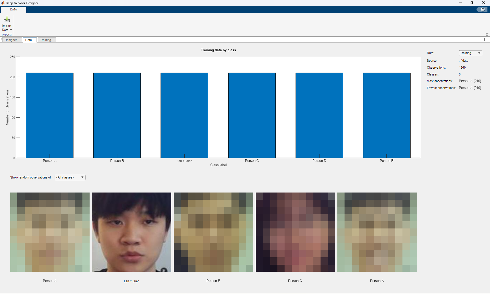
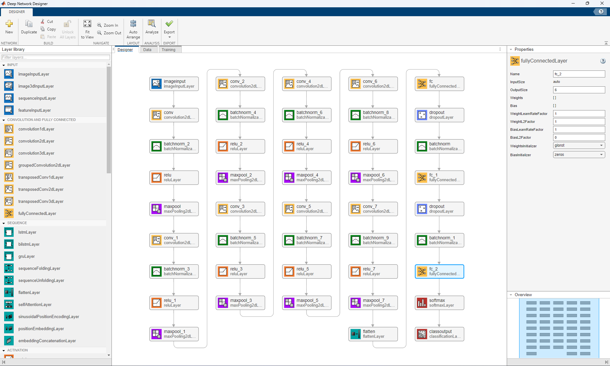
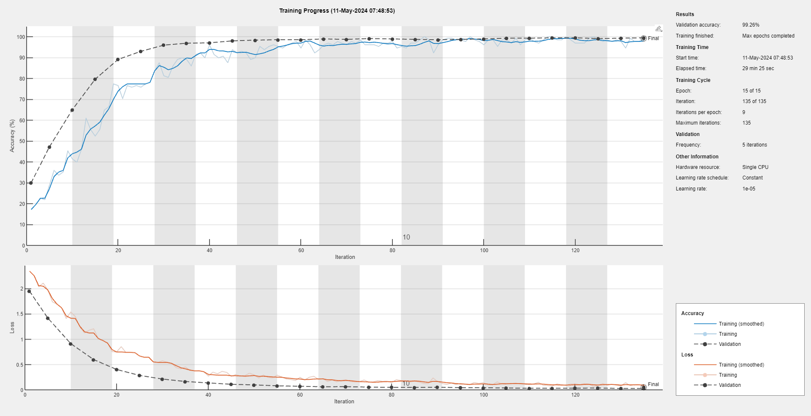
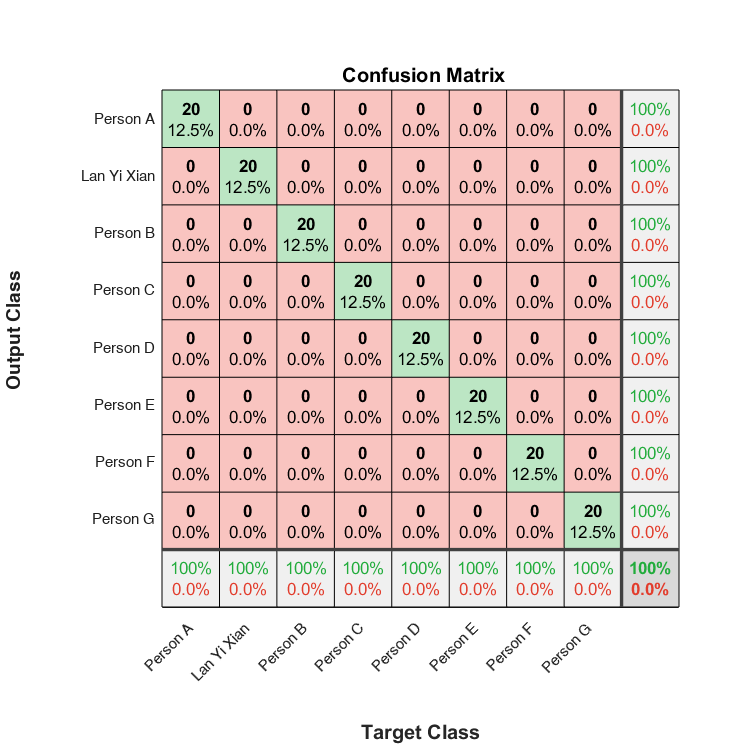

# Face Recognition: Custom CNN vs. Transfer Learning (MATLAB)

Comparing a CNN designed and trained from scratch against a fine-tuned ResNet50 for face recognition, with an ablation study on how batch normalisation and dropout affect accuracy.

> 📦 **Status:** Archived · May 2024 individual class project, Universiti Sains Malaysia

## Overview

When you only have a few hundred face images, is it better to design your own network or adapt one that's already trained? This project answers that with two approaches, built in MATLAB's **Deep Network Designer**:

1. **Custom CNN:** designed from scratch, then improved step by step by changing one thing at a time
2. **Transfer learning:** a **ResNet50** pretrained on ImageNet, with its final layers replaced and fine-tuned for face classes

  
   Round 1 training data: 1,260 face images, 210 per person. Classmates' faces are pixelated for privacy.

## Architecture

**Custom CNN**
- 224 × 224 RGB input
- **8 convolution blocks**, each: convolution → batch normalisation → ReLU → max pooling
- 3 fully connected layers with dropout and batch normalisation between them, then softmax

  
   The custom CNN in Deep Network Designer

**ResNet50 transfer learning**
- 50-layer residual network pretrained on ImageNet
- The final fully connected and classification layers were replaced to output one class per person

**Training setup:** Adam optimiser, learning rate 1e-5, mini-batch size 32, NVIDIA Quadro GPU

## Results

Each experiment changed one thing in the custom CNN and measured accuracy on held-out test images.

**Round 1: 6 people**

| Model | Change | Accuracy |
|---|---|---|
| Custom CNN | Original design | 60.32% |
| Custom CNN | + batch normalisation | 84.13% |
| Custom CNN | Dropout removed | 88.33% |
| Custom CNN | Dropout only before the final layer | **98.33%** |
| ResNet50 | Transfer learning | **100%** |

**Round 2: 8 people, 20 test images each**

| Model | Change | Accuracy |
|---|---|---|
| Custom CNN | Batch normalisation | 89.38% |
| Custom CNN | Dropout removed | 93.12% |
| ResNet50 | Transfer learning | **100%** |

<table>
  <tr>
    <td align="center" width="50%"> Best custom CNN: 99.26% validation accuracy</td>
    <td align="center" width="50%"> ResNet50: all 160 test images classified correctly</td>
  </tr>
</table>

Network diagrams, training options and training curves for every run are in `custom_cnn/`, `custom_cnn_new/` and `resnet50/`. Classmates' names are replaced with Person A–G and their faces are pixelated, to protect their privacy.

## Tech Stack

MATLAB · Deep Learning Toolbox · Deep Network Designer · ResNet50

## Project Structure

| File | Purpose |
|---|---|
| `classification_report.m` | Runs the test set and prints precision, recall, F1 and accuracy per person |
| `confusion_matrix.m` | Plots the confusion matrix for a trained network |
| `probability_analyzer.m` / `probability_analyzer_subplot.m` | Shows each test image with its predicted label and confidence |
| `test_network.m` | Classifies a single image |
| `resize.m` | Resizes a folder of images to 224 × 224 RGB |

## Getting Started

1. Install MATLAB with the **Deep Learning Toolbox** and the **ResNet-50** support package
2. Organise face images into one folder per person (folder name = class label)
3. Build and train a network in Deep Network Designer, and export it to the workspace
4. Update the hardcoded `testDataDir` paths in the scripts, then run `classification_report.m`

Face images and trained models aren't included, for privacy and size reasons.

## Lessons Learned

- **Transfer learning wins on small datasets:** ResNet50 hit 100% on both rounds, while the custom CNN needed several iterations to get close
- **Where dropout goes matters:** moving it to just before the final layer took the custom CNN from 88% to 98%
- **Batch normalisation helps a lot:** adding it alone improved accuracy by about 24 percentage points
- **Change one thing at a time:** isolating each change made it clear what actually helped
- **Be careful with 100%:** with only 120–160 test images, perfect scores say more about a small, consistent dataset than about real-world accuracy. A larger, more varied test set would be the next step

## Related Work

This is one of three approaches I explored for face recognition:

- [face-recognition-attendance-vggface](https://github.com/yx-elite/face-recognition-attendance-vggface): pretrained VGG-Face embeddings, compared by cosine and Euclidean distance
- [face-recognition-attendance-siamese](https://github.com/yx-elite/face-recognition-attendance-siamese): a Siamese network trained to learn face similarity directly (99.44% validation accuracy)
